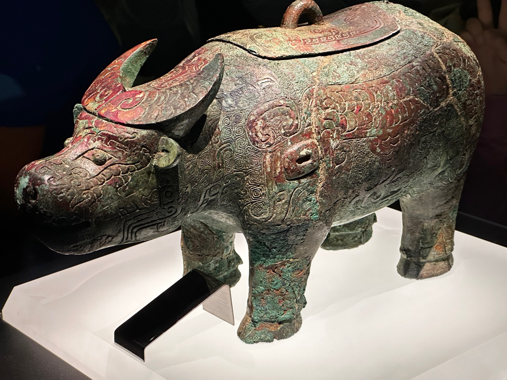
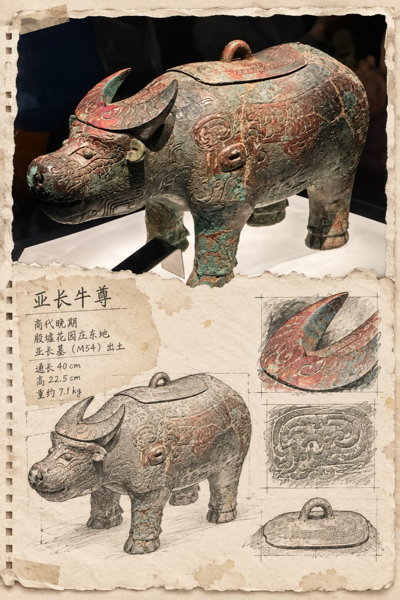
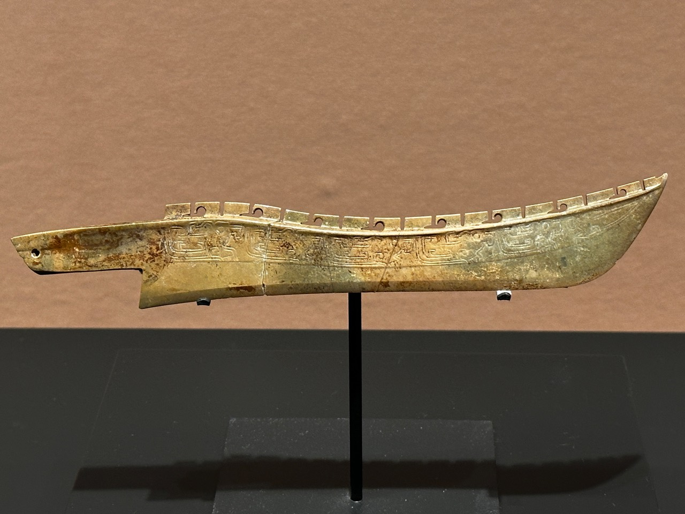
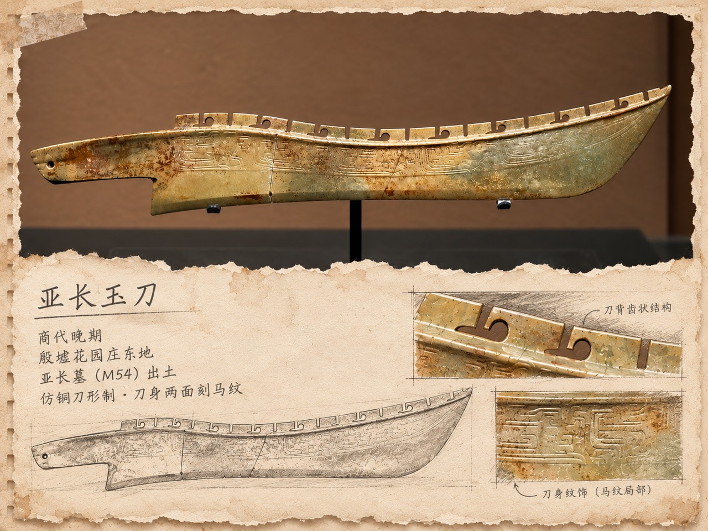
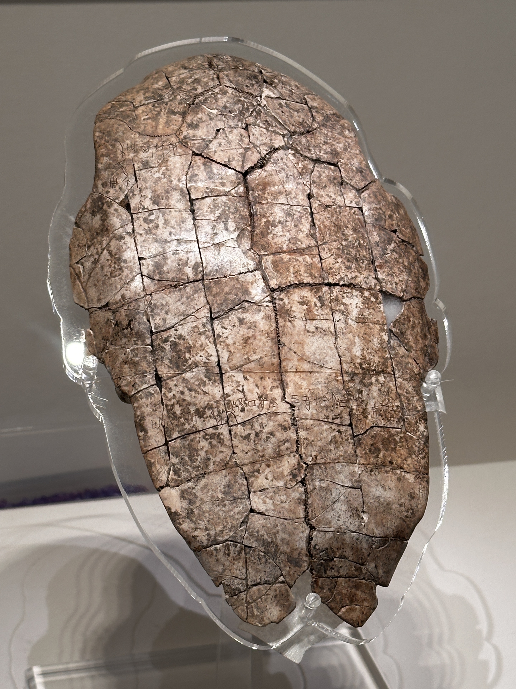
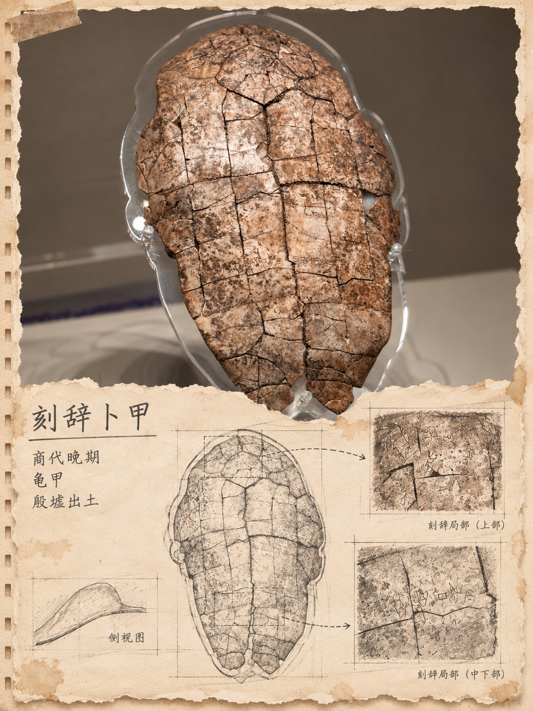
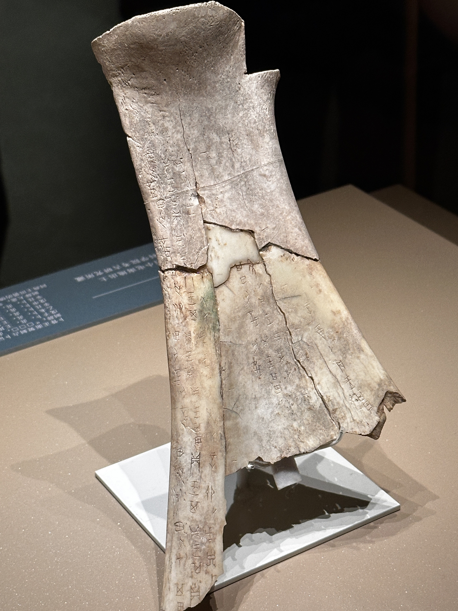
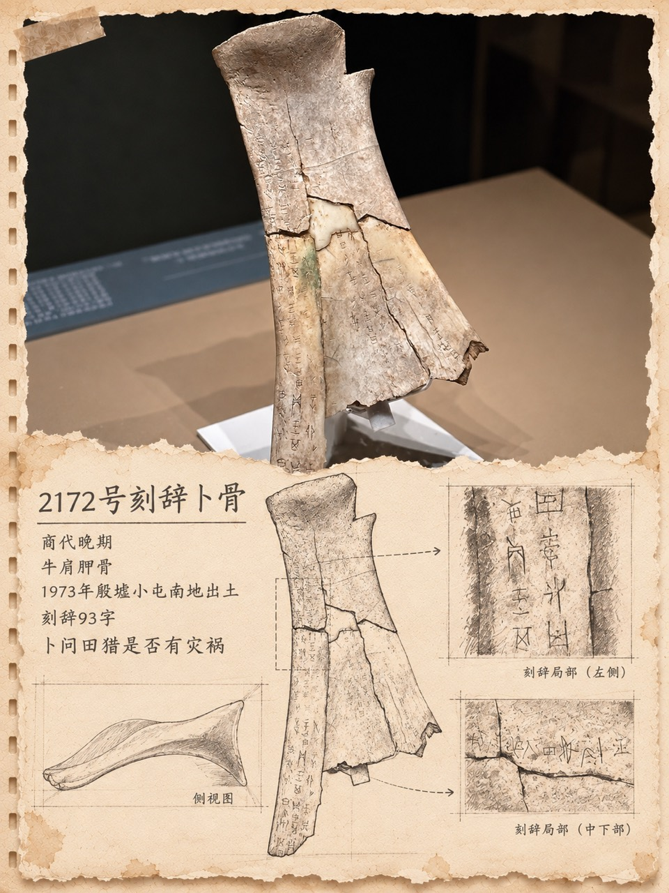

# 博物馆考古手记

把一张博物馆文物照片，制作成兼具真实摄影、复古纸张、铅笔研究线稿和局部观察的考古手记图片。

这个项目同时提供：

- 可安装到 Codex 的 `museum-archaeology-notebook` Skill；
- 普通 ChatGPT 用户可以直接复制的中文 Prompt；
- 一个可选的 Pillow 合成脚本，用于直接放置原照片、渲染中文并输出 PNG。

项目把真实性放在美观之前：不改器形，不编铭文，不凭空补纹饰；无法确认的信息宁可省略。

## 效果展示

以下案例由项目作者提供。原图和成品只用于展示与视觉参考，不属于 MIT License。

### 亚长牛尊

| 原始照片 | AI 二创成品 |
| --- | --- |
|  |  |

### 亚长玉刀

| 原始照片 | AI 二创成品 |
| --- | --- |
|  |  |

### 刻辞卜甲

| 原始照片 | AI 二创成品 |
| --- | --- |
|  |  |

### 2172 号刻辞卜骨

| 原始照片 | AI 二创成品 |
| --- | --- |
|  |  |

## ChatGPT 一键使用

1. 打开 [ChatGPT 通用 Prompt](prompts/chatgpt-prompt.md)。
2. 上传一张文物照片。
3. 复制 Prompt 全文并发送。

准备发布到小红书的纯文本版本见 [prompts/xiaohongshu-copy.txt](prompts/xiaohongshu-copy.txt)。它不依赖 Codex、Python 或本仓库中的其他文件。

## 安装 Codex Skill

推荐使用 Codex 内置的 `$skill-installer`：

1. 在 Codex 中输入 `$skill-installer`。
2. 接着发送：

   ```text
   请从 https://github.com/Zhimanaiyou/museum-archaeology-notebook/tree/main/skills/museum-archaeology-notebook 安装这个 Skill。
   ```

3. 安装完成后，可在下一轮对话中使用；如果没有立即出现，重启 Codex。

安装后可以这样使用：

```text
使用 $museum-archaeology-notebook，把我上传的文物照片制作成一张考古研究手记。
```

## 支持范围

第一版支持青铜器、玉器、陶器、甲骨、石刻及其他主体清楚的博物馆文物照片。

第一版不支持自然风光、城市、建筑摄影、考古遗址或大型墓葬空间复原，也不支持视频。

## 可选的确定性合成脚本

Skill 优先使用现有图像能力制作纸张和线稿素材，再直接合成原始照片。没有图像生成能力时，也可以用脚本生成较朴素的基础版：

```powershell
python -m pip install -r skills/museum-archaeology-notebook/scripts/requirements.txt
python skills/museum-archaeology-notebook/scripts/compose_notebook.py `
  --input examples/ya-chang-jade-knife/original.jpg `
  --output output/jade-knife.png `
  --title "亚长玉刀" `
  --fact "商代晚期"
```

脚本默认完整容纳原照片，不覆盖输入文件；机械边缘线稿只是安全回退，不等同于正式考古测绘图。

## 常见问题

**会不会把文物重新画错？**  
最终照片区域应直接使用原文件。AI 只参与辅助素材，铭文和复杂纹饰局部优先直接裁取原图。

**一定要知道文物的准确名称吗？**  
不需要。无法确认时使用有依据的类别名称，或省略不确定信息。

**为什么不是每张图都放很多局部？**  
研究价值和真实性高于装饰密度。通常一至两处局部已经足够。

**需要付费 API 吗？**  
默认不需要。Skill 不会在未经同意时切换到需要 API Key 的付费流程。

## 局限性

- 图像模型可能改变细小纹饰或生成错误中文，因此最终结果仍需人工查看。
- 照片模糊、反光严重或展签不可读时，能够可靠呈现的信息会更少。
- 自动生成的铅笔线稿不是正式考古测绘成果。
- 实际图像生成效果会随所用模型和产品能力变化。

## 项目结构

```text
examples/                                  四组真实案例
prompts/                                   ChatGPT 与小红书 Prompt
skills/museum-archaeology-notebook/        可安装的 Codex Skill
  SKILL.md
  agents/openai.yaml
  references/
  scripts/
tests/                                     轻量测试
```

## 版权与许可

- Skill、脚本和说明文档：采用 [MIT License](LICENSE)。
- `examples/` 中的原始摄影与 AI 二创成品：版权所有，未经权利人授权不得商业使用、转载或重新发布；它们不适用 MIT License。详见 [examples/README.md](examples/README.md)。

使用者还应确认自己有权处理和发布上传的照片，并遵守博物馆现场拍摄、馆藏图像及平台的相关规定。
